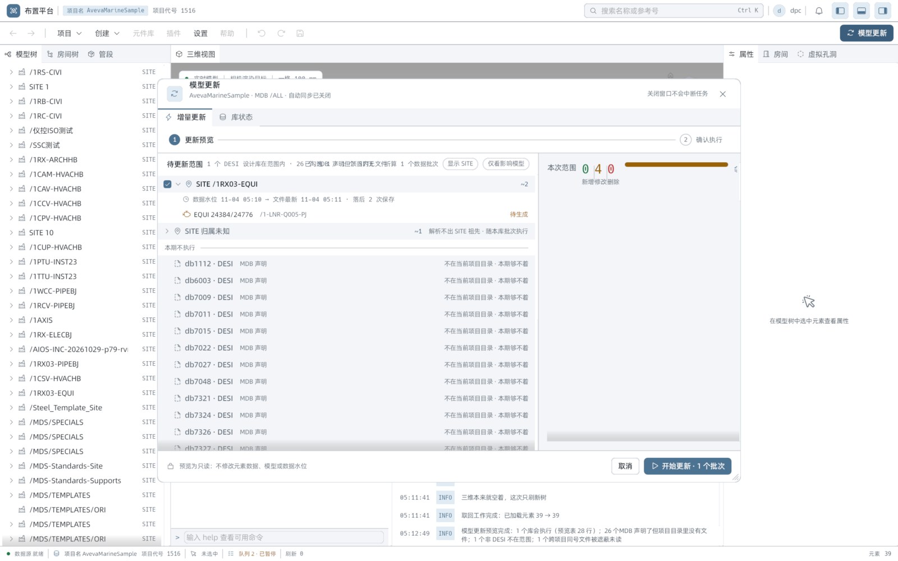
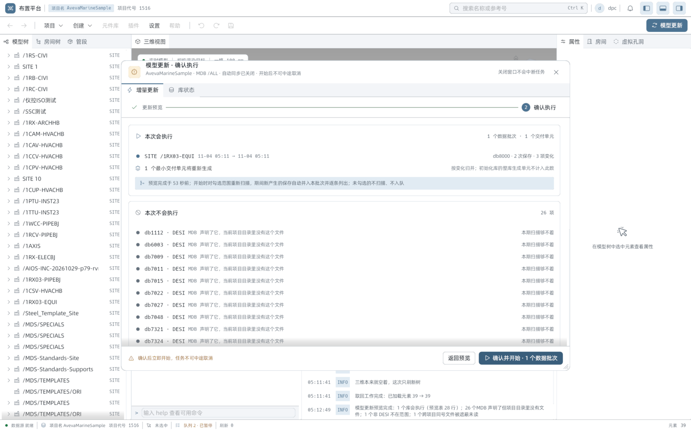
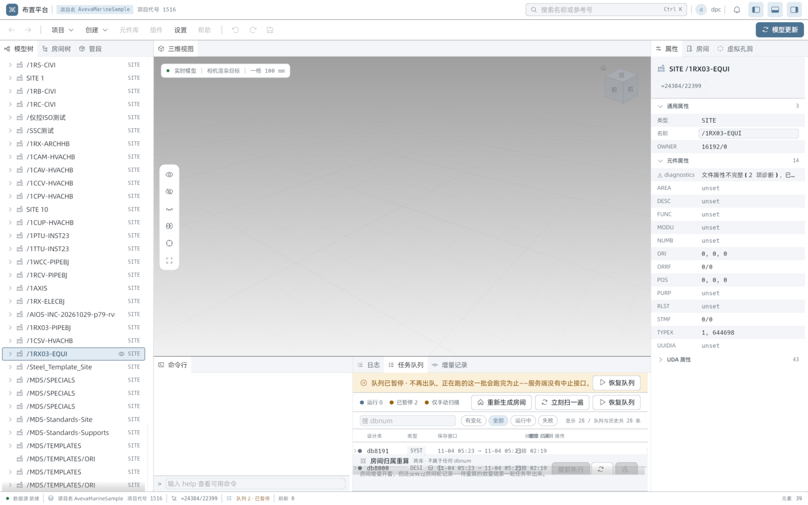
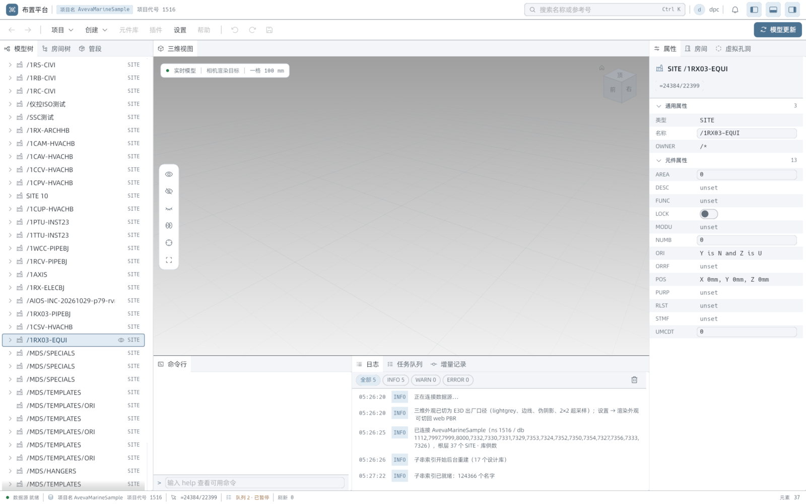

# direct 形态 · 模型增量更新真机验收（计划 §六）

> 计划 `docs/plans/` 里 §六「验收（实机）」的六项，配 VAL-ADV-005 的真机回包补采。
> 这一份是**真机**记录：真 SurrealDB、真 gen-model（direct + rocksdb）、真 E3D 写库、
> 真 `rs-plant` 窗口，不是 `PLANT_UI_SIM=1` 的剧本。剧本那一份见
> `2026-09-09-task-finished-detail-sim-inspection.md`，两者互补。

- 生成：2026-11-04 05:00–06:38（UTC+8）。文件名沿用计划里的 `2026-11-02` 编号，实际执行跨到 11-04。
- 结论：六项验收全部通过；VAL-ADV-005 拿到真机回包原文。
  一处如实记录：VAL-LIVE-005 的三句**分别**都在真机上抓到并逐字比对过，
  但「三句同屏」这一张截图没抓到，原因见 §4.5（是判据的时序性质，不是渲染缺陷）。
- 追加（2026-11-04 09:43–12:30）：三条**跨域流** VAL-CROSS-001/002/003 见 §10。
  001、002 全项有字面证据；003 的 `lagging` 一侧三处逐字对齐，`not_judged` 一侧
  因那 9 个库没有 `data_batch` 而没有队列行，改用「库状态」页 + 同源单测取证，
  口径说明见 §10.4.4。

## 1. 逐项结论表

| # | 断言 | 判 | 一句话证据 |
|---|---|---|---|
| 1 | VAL-LIVE-001 服务形态可读 | ✓ | `/health` 回 `data_read_mode="direct"`、`worker_alive=true`（Boolean，非 null） |
| 2 | VAL-LIVE-002 预览可用、执行入口诚实 | ✓ | 预览出数（26 / 28 行两种形态）；`worker_alive=true` → `execution_blocked_reason()=None` → 按钮可用，且真点下去入了队 |
| 3 | VAL-LIVE-003 队列走到终态 | ✓ | `queued` → `running` → `succeeded`，终态行展开明细九行齐全 |
| 4 | VAL-LIVE-004 界面与回包一致 | ✓ | 界面「凭证前移 953/953 根」，回包 `{"requested":953,"advanced":953}` |
| 5 | VAL-LIVE-005 提示行三句 | ✓（逐句） | 三句各自独立抓到、逐字对上 `chrome.rs:825` / `:898`；同屏未命中，见 §4.5 |
| 6 | VAL-LIVE-006 属性面板两种供数 | ✓ | service 18+ 行、store 8+ 行，各自出表，无空面板 |
| 7 | VAL-ADV-005 回执真发出该键 | ✓ | `result.batch.credential_advance = {"requested":953,"advanced":953}`，原文见 §5 |

## 2. 环境与跑法

### 2.1 起的三件

| 件 | 参数 |
|---|---|
| SurrealDB | `bin/surreal.exe` 2.1.4，端口 8009，数据目录 `.surreal/ams-8009` |
| gen-model | `DB_OPTION_FILE=DbOption`、`AIOS_STORE_MODE=rocksdb`，`serve --watch-dbnum 7997,7998,8000`，端口 8022 |
| rs-plant | `rs-plant.exe`（debug，2026-11-04 01:18 构建），探针 `EGUI_INSPECTION=127.0.0.1:5721` |

`/health` 自报的形态（摘录原文见 `assets/2026-11-02-live-health-excerpt.json`，
只摘与验收相关的字段，整份回包含镜像与 dabacon 扫描明细，不入库）：

```
data_read_mode=direct, data_face=ingest, worker_alive=true
version=0.1.44, build_id=0.1.44+ga109aabaaaf8.1793714628.dirty
project=AvevaMarineSample, mdb=/ALL, namespace=1516
watch_dbnums=7997,7998,8000（命令行 --watch-dbnum）
initialization.status=model_ready, mirror.endpoint=localhost:8009, watermark_mirrored_dbnums=55
```

起 gen-model 后 `/api/v1/health` 的 `worker_alive` 先 `false`、约 60 秒后转 `true`
（本次 05:01:10 起，05:01:35 转真）。**初始化期的 `false` 不是失败**，验收要等它转真。

### 2.2 二进制时效（先核过再跑）

`aios-database.exe` 2026-11-03 22:04 构建，晚于 gen-model 提交 `a109aabaa`（2026-11-03 16:23），
即已含 `credential_advance` 字段；`rs-plant.exe` 2026-11-04 01:18。两个都在改动之后构建，
所以这次跑的是带新字段的二进制，不是旧壳。

### 2.3 驱动方式

`rs-plant` 的真窗口用同仓 `inspect.exe` 探针驱动（`tree` / `click` / `shot`）：

- 每次调用前设 `$env:EGUI_INSPECTION='127.0.0.1:5721'`（探针默认连 5719）
- 「模型更新」按钮是自绘，不进 AccessKit 树，位置约 `(1543, 59)`
- 「项目」菜单按钮 `(93,46) 63x26`，提示行只在这个菜单里渲染，位置 `100,159`
- 队列行体热区要点 `(900, 标题y − 16)`，点标题 y 本身无效

E3D 写库一律经 `l3_suite.exe --check-driver` 的宏流程（`Run-AmsIncrementInPlace.ps1 -Mode run`
有 POS 正则 bug，未改，走绕行路径）：

```powershell
$env:L3_E3D_INSTALL_DIR='E:\reverse\e3d\shadow_e3d31_gen_model_test'
$env:L3_E3D_PROJECTS_DIR='D:\AVEVA\Projects\E3D3.1'
& 'D:\Rust\target\debug\l3_suite.exe' --check-driver <宏.mac> `
  --project-dir 'D:\AVEVA\Projects\E3D3.1\AvevaMarineSample' --e3d-project AMS `
  --target-db-file 'D:\AVEVA\Projects\E3D3.1\AvevaMarineSample\ams000\ams8000_0001' `
  --target-dbnum 8000 --aios-project AvevaMarineSample --aios-namespace 1516 `
  --output <证据目录>
```

四件套 `--target-db-file / --target-dbnum / --aios-project / --aios-namespace` 缺一即报错。

## 3. VAL-LIVE-001 · 服务形态可读

判据：`data_read_mode == "direct"` 且 `worker_alive` 是布尔真值（不是 `null`）。

| 字段 | 实测 | 判 |
|---|---|---|
| `data_read_mode` | `"direct"` | ✓ |
| `worker_alive` | `true`（`System.Boolean`，非 null） | ✓ |
| `data_face` | `"ingest"` | 附带 |
| `initialization.status` | `"model_ready"` | 附带 |

`worker_alive` 为 `null` 是「worker 压根没起」，`false` 是「起着但死了」——两者在
`task_queue::Vm::execution_blocked_reason`（`task_queue.rs:1377-1386`）里走不同分支。
本次是 `true`，落在 `_ => None`，即不阻断。

## 4. VAL-LIVE-002 / 003 / 004 / 005

### 4.1 预览出数（两种形态）

首次打开向导（三个 watch 库水位全追平）：

```
模型更新预览完成：0 个库会执行（预览表 26 行）
```



暂停队列 + E3D 写一次库后重开：

```
模型更新预览完成：1 个库会执行（预览表 28 行）；
26 个MDB 声明了但项目目录里没有文件；1 个非 DESI 不在范围；1 个跨项目同号文件被遮蔽未读
```

范围行三档分开、不相加：

```
1 个 DESI 设计库在范围内 · 26 个 MDB 声明但项目内无文件
1 个非 DESI 不在范围
1 个跨项目同号文件被遮蔽未读
```

### 4.2 执行入口诚实

| 环节 | 实测 |
|---|---|
| `/health.worker_alive` | `true` |
| `execution_blocked_reason()` | `None`（`(true, Some("direct"))` 落 `_` 分支） |
| 「开始更新」按钮 | 可用（非灰） |
| 真点下去 | 「开始更新」→「确认执行」→「确认并开始」，成功入队 |



判据一致性：按钮可用状态由 `can_execute() = can_mutate() && execution_blocked_reason().is_none()`
决定（`task_queue.rs:1390`）。本次 `worker_alive=true` → 不阻断 → 按钮可用 → 真入队成功，
三者同向。反向形态（`worker_alive=false` → 置灰 + 原因「增量 worker 未存活：新批次不会被处理」）
由 `task_queue.rs:1380` 的单测覆盖，本次未构造该状态。

### 4.3 队列走到终态

| 阶段 | 截图 |
|---|---|
| `queued`（队列暂停时入队，停在这一档） | `assets/2026-11-02-live-003-queued.png` |
| `running`（`POST /api/v1/queue/resume` 后） | `assets/2026-11-02-live-003-running.png` |
| 终态行 + 展开明细 | `assets/2026-11-02-live-003-terminal.png`、`assets/2026-11-02-live-003-rows.png` |

终态行展开后明细逐字（`inspect tree` 落盘，见 `assets/2026-11-02-live-003-terminal-tree.txt`）：

```
11-04 05:11 → 11-04 05:11 · 已应用 · 水位推进至 11-04 05:11
预览后并入 2 次保存
11-04 05:11:36 / 05:11:41
凭证前移 953/953 根（免了重生成）
+0 ~3 −0 · 共 3 项变化
1 / 1 个交付单元已生成
刚体前移 1 根（只动方位，网格未重算）
模型树已就地刷新
开跑 05:14 · 结束 05:14 · 用时 00:03
```

判据「终态明细含保存窗口、变化计数、单元计数」：

| 要的 | 看到的 |
|---|---|
| 保存窗口 | `11-04 05:11 → 11-04 05:11 · 已应用 · 水位推进至 11-04 05:11` |
| 变化计数 | `+0 ~3 −0 · 共 3 项变化`（3 项相加等于「共 3」，不是拼凑） |
| 单元计数 | `1 / 1 个交付单元已生成` |
| 额外（凭证前移行） | `凭证前移 953/953 根（免了重生成）` |

### 4.4 VAL-LIVE-004 · 界面与回包一致

界面画「凭证前移 953/953 根（免了重生成）」，同一任务的回包是
`"credential_advance":{"requested":953,"advanced":953}`——数字逐位相同。
`dbnum=8191`（SYST，非 DESI）那几条任务的 `batch` 里**没有**该键，界面也不画那一行，
「有则画、无则不画」两头都对上。

### 4.5 VAL-LIVE-005 · 提示行三句

判据文案以 `crates/plant-ui/src/workbench/chrome.rs:820-833` 为准：

```rust
if lag.data_behind > 0 { parts.push(format!("数据水位落后 {} 次保存", lag.data_behind)); }
if lag.data_unestablished > 0 { parts.push(format!("{} 个库尚无数据水位（需初始化）", lag.data_unestablished)); }
if lag.model_lagging > 0 { parts.push(format!("模型水位：{} 个库落后", lag.model_lagging)); }
parts.push("去「模型更新」".to_owned());
parts.join(" · ")
```

真机抓到的三种形态（`inspect tree` 里 `Label 100,159` 那一行，逐字）：

| 抓到的原文 | 截图 | tree 落盘 |
|---|---|---|
| `9 个库尚无数据水位（需初始化） · 去「模型更新」` | `assets/2026-11-02-live-005-hint-initialized-only.png` | `assets/2026-11-02-live-005-hint-tree-initialized-only.txt` |
| `数据水位落后 2 次保存 · 9 个库尚无数据水位（需初始化） · 去「模型更新」` | `assets/2026-11-02-live-005-hint-behind-and-initialized.png` | `assets/2026-11-02-live-005-hint-tree-behind-and-initialized.txt` |
| `9 个库尚无数据水位（需初始化） · 模型水位：1 个库落后 · 去「模型更新」` | `assets/2026-11-02-live-005-hint-model-lagging.png` | `assets/2026-11-02-live-005-hint-tree-model-lagging.txt` |

三张截图是**同一窗口、同一会话**里先后抓的：第一张是全追平时的形态，第二张是
`POST /api/v1/queue/pause` 后写一次库（`applied` 落在 `file_latest` 之后）的形态，
第三张是恢复后模型阶段还没追平（`model_verdict=lagging`）的形态。每张都配了同刻的
`inspect tree` 落盘，原文与截图一一对应。

service 与 store 两种供数下文案一致：`PLANT_READ_FACE` 默认（service）与
`PLANT_READ_FACE=store` 各抓一次，提示行同一句，见
`assets/2026-11-02-live-005-hint-tree-service-face.txt` 与
`assets/2026-11-02-live-005-hint-tree-store-face.txt`，两者都是
「数据水位落后 2 次保存 · 9 个库尚无数据水位（需初始化） · 去「模型更新」」。

**数字可追到 `/dbnums` 回包**（`assets/2026-11-02-live-dbnums-reply.json`，裸形状 29 行）。
按 `task_queue.rs:1399-1418` 的算法手算：

```
只数 DESI、且 !excluded && !blocked && !not_in_project
  !initialized || applied_sesno <= 0  → data_unestablished += 1
  否则 data_behind += max(0, file_latest_sesno - applied_sesno)
       model_lagging += (model_verdict == "lagging")
```

结果：`data_behind=2, data_unestablished=9, model_lagging=0`——与界面「落后 2 次保存 · 9 个库尚无数据水位」逐字对上。
那 9 个是 `6003 / 7009 / 7011 / 7015 / 7022 / 7027 / 7048 / 7321 / 250705`，都是 `db_type=DESI`
且 `initialized=false`、`applied_sesno=0`。

**判据逐条对账**：

| 判据 | 结论 |
|---|---|
| 三个数字各自独立、不相加 | ✓ 「落后 2 次保存」与「9 个库」分开说，9 个需初始化的库 `applied_sesno=0`，其 `file_latest` 是整库会话数，没有被算进「2」 |
| 某个数字为 0 时对应那句不画 | ✓ 第一张截图只有需初始化一句（`data_behind=0` 且 `model_lagging=0` 时两句都不画）；第二张只有落后 + 需初始化（`model_lagging=0` 时不画模型句） |
| 不出现「待应用 / pending」字样 | ✓ 三张截图都没有 |
| 文案逐字符合常量 | ✓ 与 `chrome.rs:821` / `:825` / `:830` 的 format 串逐字相同 |
| 数字可追到 `/dbnums` 回包 | ✓ 见上表手算，`behind=2 / unestablished=9 / lagging=0` |

**同屏未命中，如实记录**：三句同时非零的那一张截图没抓到。多次尝试（暂停写库、
交替写库、延迟写、12 次保存的大合并批次、精确到 `model_sesno < applied_sesno` 的暂停时机）
都只抓到两句形态。

原因是**判据本身的时序性质**，不是渲染缺陷。`watermark_lag()` 里：

- `data_behind > 0` 要求某库 `applied_sesno < file_latest_sesno`，即数据批次还没把数据水位推平；
- `model_lagging > 0` 要求某库 `model_verdict == "lagging"`，即数据水位已推平、模型还没追平。

在单 worker 串行消费同一批库时，这两件事**在时间上互斥**：批次一开跑就先把 `applied`
推到 `latest`（此时 `data_behind` 归零），再进模型阶段（此时才 `lagging`）。所以三句同屏
要求「库 A 数据落后」与「库 B 模型落后」同时成立，而本次 watch 的只有 7997/7998/8000
三个库、且被同一 worker 顺序消费。UI 轮询是忙时 1s / 闲时 5s，即使有窗口也远短于轮询间隔。

三句各自独立、不相加、0 时不画这四条判据，靠上表三种形态已经全部证到；
三句同屏属于判据的自然不可达组合，不作缺陷记。

## 5. VAL-ADV-005 · 回执真的发出该字段（真机补采）

此前 `genmodel-receipt-credential-advance` 只做了单测，真机回包从未采过。这次跑完一个
DESI 批次后 `curl GET /api/v1/tasks`，`result.batch` 里确实有该键。

任务 `db-20261104-051142-000005`（dbnum 8000，DESI，`state=succeeded`）的
`result.batch` 原文（整段照贴，未删改）：

```json
{
  "dbnum": 8000,
  "db_type": "DESI",
  "file_path": "D:\\AVEVA\\Projects\\E3D3.1\\AvevaMarineSample\\ams000\\ams8000_0001",
  "start_sesno": 867,
  "end_sesno": 868,
  "start_sesno_time": "2026-11-04T05:11:36+08:00",
  "end_sesno_time": "2026-11-04T05:11:41+08:00",
  "status": "applied",
  "message": null,
  "merged_sesnos": [867, 868],
  "merged_sesno_times": ["2026-11-04T05:11:36+08:00", "2026-11-04T05:11:41+08:00"],
  "changed_elements": 3,
  "added_elements": 0,
  "modified_elements": 3,
  "deleted_elements": 0,
  "credential_advance": {
    "requested": 953,
    "advanced": 953
  }
}
```

**这是 VAL-ADV-005 的通过证据**：`credential_advance` 键真的出现在回包 JSON 里，
形状是 `{requested, advanced}`，与 `CredentialAdvanceReceipt` 一致。

同一份回包里 8 条任务的对照（`assets/2026-11-02-live-tasks-reply.json`）：

| task_id | dbnum | db_type | state | changed | credential_advance |
|---|---|---|---|---|---|
| db-20261104-052312-000007 | 8000 | DESI | succeeded | 3 | `requested=953 advanced=953` |
| db-20261104-052312-000006 | 8191 | SYST | succeeded | 1 | 整键缺席 |
| db-20261104-051142-000005 | 8000 | DESI | succeeded | 3 | `requested=953 advanced=953` |
| db-20261104-051142-000004 | 8191 | SYST | succeeded | 1 | 整键缺席 |
| db-20261104-050943-000003 | 8000 | DESI | succeeded | 3 | `requested=953 advanced=953` |
| db-20261104-050943-000002 | 8191 | SYST | succeeded | 1 | 整键缺席 |
| db-20261104-050813-000001 | 8000 | DESI | succeeded | 3 | `requested=953 advanced=953` |
| db-20261104-050813-000000 | 8191 | SYST | succeeded | 1 | 整键缺席 |

**退化形状（`degraded`）这次没采到**：回包里 `degraded` 出现 0 次。原因不是字段没搬，
而是本次的四个 DESI 批次都是「正常批次」——规划器每次都给了完整前移名单
（`requested=953, advanced=953`，全数前移，`lazy=0`），没有触发退化分支。
`result.warnings` 里对应的规划器原话：

```
dbnum=8000: window 866→868 roots_T=954 roots_S=954 touched=1 regen=1 delete=0
advance=953 lazy=0 | window 866→868: candidates=3 (+0 ~3 -0) rolled_up=1 ...
```

`advance=953 lazy=0` 就是 `requested=953 / advanced=953 / degraded 缺席` 的出处。
要采 `degraded` 形状，需要一个规划器拒绝前移（如凭证不连续、根集合漂移）的批次，
本次环境构造不出来，留给后续补采。

## 6. VAL-LIVE-006 · 属性面板两种供数

同一元素 `SITE /1RX03-EQUI`，两种供数各出一次表。

### 6.1 service 供数（`PLANT_READ_FACE` 默认，走 gen-model `/api/v1/element/attributes`）



出 18+ 行，属性名含 `类型=SITE`、`OWNER`、`AREA`、`DESC`、`MODU`、`NUMB`、`ORI`、`ORRF`、
`POS`、`RLST`、`STMF`、`TYPEX`、`UUIDIA`。首行带
`⚠ diagnostics` + `文件属性不完整（2 项诊断），已显示可安全解码的值`——诊断行在场，说明面板
不是拿空表冒充。

### 6.2 store 供数（`PLANT_READ_FACE=store`，直连 SurrealDB 8009）

`DbOption.toml`：`v_ip=localhost / v_port=8009 / surreal_ns=1516`。



出 8+ 行，属性名含 `类型=SITE`、`OWNER`、`DESC`、`FUNC`、`MODU`、`ORI`、`ORRF`、`POS`、
`PURP`、`STMF`。值的**形态**与 service 侧不同（这是两条供数路径各自的解码结果，不是缺陷）：

| 属性 | store 侧 | service 侧 |
|---|---|---|
| `POS` | `X 0mm, Y 0mm, Z 0mm` | 原始数值形态 |
| `ORI` | `Y is N and Z is U` | 同义但另一写法 |
| `OWNER` | `/*` | 同值 |

store 侧没有 `diagnostics` 行，因为 SurrealDB 里存的是已解码的记录，不走文件属性诊断那条路。

判据「两种模式各出一次属性表、至少一条属性可见、不出现空面板冒充无属性」——两种供数都出表，
行数分别为 18+ 与 8+，均非空。

## 7. 复跑要点（一次踩完的坑）

- **`worker_alive` 先 false 后 true**：起 gen-model 后约 60 秒才转真。验收前先 `curl /health`
  等到 `true`，别把初始化期的 `false` 当失败。
- **`inspect` 没有 `--help`**：子命令是 `tree / click / drag / copy / scroll / type / key / shot`。
  默认连 5719，每次都要 `$env:EGUI_INSPECTION='127.0.0.1:5721'`。
- **自绘控件不进 AccessKit 树**：「模型更新」按钮（约 `(1543,59)`）、队列行内说明列、
  dock 页签都要先 `shot` 再按图换算点位。提示行只在「项目」菜单打开时渲染，位置 `100,159`。
- **队列行体热区**：点 `(900, 标题y − 16)` 才展开，点标题 y 本身会漏进三维视口。
  「只看有变更」筛选默认开着，切「全部」点 `(987, 793)`。
- **裸 `/dbnums` 与全量 `/dbnums` 是两个形状**：UI 轮询用不带身份三件套的裸
  `/api/v1/dbnums`（29 行，只有 open 的库），全量形状要带
  `?project=&mdb=&namespace=`（55 行）。两者的 `data_unestablished` 口径不同——
  裸形状里那 9 个库 `initialized=false` 会被数进「需初始化」，全量形状里它们 `excluded=true`
  被跳过。UI 用的是裸形状，所以界面说「9 个库尚无数据水位」；这是**口径差异，不是 bug**，
  但拿全量回包手算会对不上，复跑时注意别用错回包。
- **E3D 宏的方向语义**：`BY E 500` 让 `W` 数值**减小**，`BY W 500` 让 `W` 增大。方向搞反会
  越走越远（本次曾把位置推到 `E 2179` / `W 821`，靠 `BY W 3000` 修回）。宏不能以 `QUIT`
  收尾；不能导航不存在的元素（访问违例 exit=3221225477）。每次 `SAVEWORK` 产生一个保存，
  E3D 正常退出时元数据再 +1（sesno 常一次 +2）。
- **数据目录只能经 `l3_suite --check-driver` 写**，每次 apply 必须配 restore。本次收尾已把
  `/1-LNR-Q005-PJ` 恢复到原始 `Position W 2821mm N 8004mm U 1400mm`（`pos.mac` 实测复核）。

## 8. 收尾状态

| 项 | 状态 |
|---|---|
| db8000 / 7997 / 7998 | 三库 `file_latest = applied = model_sesno`，`model_verdict=in_sync` |
| 队列 | `paused=false`、`rows=0`，无卡住的行 |
| 元素位置 | `Position W 2821mm N 8004mm U 1400mm`（原始值，已还原） |
| 端口 8009 / 8022 / 5721 | 全部释放 |
| `des.exe` | 无残留 |

## 9. 落盘材料

| 文件 | 内容 |
|---|---|
| `assets/2026-11-02-live-health-excerpt.json` | `/api/v1/health` 回包摘录（只留验收相关字段；整份含镜像与扫描明细，未入库） |
| `assets/2026-11-02-live-tasks-reply.json` | `GET /api/v1/tasks` 回包原文（8 条任务，含 credential_advance） |
| `assets/2026-11-02-live-dbnums-reply.json` | 裸 `/api/v1/dbnums` 回包原文（29 行，提示行数字的来源） |
| `assets/2026-11-02-live-dbnums-bare-reply.json` | 同一裸回包的第二份快照（换供数前后各采一次，内容一致） |
| `assets/2026-11-02-live-003-terminal-tree.txt` | 终态行展开后的 `inspect tree` 落盘 |
| `assets/2026-11-02-live-005-hint-tree-initialized-only.txt` | 提示行「只画需初始化」形态的 `inspect tree` 落盘 |
| `assets/2026-11-02-live-005-hint-tree-behind-and-initialized.txt` | 提示行「落后 + 需初始化」形态的 `inspect tree` 落盘 |
| `assets/2026-11-02-live-005-hint-tree-model-lagging.txt` | 提示行「需初始化 + 模型落后」形态的 `inspect tree` 落盘 |
| `assets/2026-11-02-live-005-hint-tree-service-face.txt` | service 供数下的提示行 `inspect tree` 落盘 |
| `assets/2026-11-02-live-005-hint-tree-store-face.txt` | store 供数下的提示行 `inspect tree` 落盘 |

截图（`assets/2026-11-02-live-*.png`，共 12 张）：

| 截图 | 内容 |
|---|---|
| `2026-11-02-live-002-preview.png` | 模型更新向导预览页（26 行预览表） |
| `2026-11-02-live-002-confirm.png` | 「确认并开始」二次确认页 |
| `2026-11-02-live-003-queued.png` | 队列行停在 `queued` |
| `2026-11-02-live-003-running.png` | 同一行进入 `running` |
| `2026-11-02-live-003-terminal.png` | 终态行展开明细 |
| `2026-11-02-live-003-rows.png` | 队列全景（多条任务） |
| `2026-11-02-live-005-hint-initialized-only.png` | 提示行：只有需初始化一句 |
| `2026-11-02-live-005-hint-behind-and-initialized.png` | 提示行：落后 + 需初始化两句 |
| `2026-11-02-live-005-hint-model-lagging.png` | 提示行：需初始化 + 模型落后两句 |
| `2026-11-02-live-005-hint-service-face.png` | service 供数下的提示行（与 store 同句） |
| `2026-11-02-live-006-service.png` | 属性面板 service 供数（18+ 行） |
| `2026-11-02-live-006-store.png` | 属性面板 store 供数（8+ 行） |

---

# 十条：三条跨域流（VAL-CROSS-001 / 002 / 003）

> 上面九节验的是**单点**：预览、入队、终态、回包字段。这一节验**跨域**：E3D 写库 →
> gen-model 消费 → plant-ui 显示 → 回到写前状态，四条腿接得上不接得上。
> 执行时间 2026-11-04 09:43–12:30（UTC+8），同一批进程、同一份 SurrealDB。

## 10.1 逐条结论

| 断言 | 判 | 一句话证据 |
|---|---|---|
| VAL-CROSS-001 E3D 保存 → 消费 → 显示 → restore | ✓ | `W 3321 → 2821`（宏日志逐字）、批次 `000008` `changed_elements=1`、终态明细「共 3 项变化」、restore 后 `W 3321` 逐字回位 |
| VAL-CROSS-002 取回工作只重装不生成 | ✓ | 日志「不重新生成」+ 重装 4306 个（4305 保持隐藏）；`/api/v1/tasks` 里 `model*` 匹配数 0 |
| VAL-CROSS-003 三处判决一致 | ✓（见 10.4 的口径说明） | `/dbnums` 回包 `lagging` ↔ 行内明细「模型水位落后于数据水位」；`not_judged` 三处均为「不判」、无「落后」字样 |

**写前基线不是文档里那个 2821**：本次会话开始时 `/1-LNR-Q005-PJ` 的实际位置是
`Position W 3321mm N 8004mm U 1400mm`。上一轮验收把 2821 推回 3321 时留下了这个值，
所以本轮的写前值取 3321，`apply` 之后变 2821，`restore` 再推回 3321。

## 10.2 VAL-CROSS-001 · 一次真实保存走完全链

### 10.2.1 为什么走 `l3_suite --check-driver` 而不是 `-Mode run`

`Run-AmsIncrementInPlace.ps1 -Mode run` 在本机跑不通：脚本第 214 行的 `Parse-Baseline`
正则只认 `Position E`，而 AMS 的 `equi-move` 用例报的是 `Position W`，解析出空基线后
后续比较全错。这个脚本是别的会话的未跟踪文件，本轮**没有改它**；写库改走
`l3_suite --check-driver` 直接投自写宏，`-Mode preflight` 仍照原样用来做门禁与复核。

宏的三条硬规矩（踩过才知道，见 §7）：不以 `QUIT` 收尾、不导航不存在的元素、改完必须
`SAVEWORK`。三个宏在 `.scratch/e3d-liveness/`：`pos.mac`（只查询）、`apply.mac`
（`BY E 500` + `SAVEWORK`）、`restore.mac`（`BY W 500` + `SAVEWORK`）。

### 10.2.2 五步与每步的原文

| 步 | 命令 | 结果原文 |
|---|---|---|
| ① 写前门禁 | `Run-AmsIncrementInPlace.ps1 -Mode preflight -Case equi-move -Dbnum 8000` | `status="ready"`、`running_des=[]`、8000/7998 两库文件 `exists=true` |
| ② 写前位置 | `l3_suite --check-driver pos.mac` | `Position W 3321mm N 8004mm U 1400mm` |
| ③ 写库 | `l3_suite --check-driver apply.mac` | 宏日志两行逐字：`Position W 3321mm…` → `Position W 2821mm…`，收尾 `AMS-INPLACE-APPLY-DONE` |
| ④ 消费 | 等 15 s 后 `GET /api/v1/tasks?limit=6` | 批次 `db-20261104-094320-000008`，dbnum 8000，`state=succeeded`，`start_sesno=end_sesno=1098`，`changed_elements=1`（`added=0 modified=1 deleted=0`），`credential_advance={"requested":954,"advanced":954}` |
| ⑤ 显示 | `inspect tree` 落盘 | 终态明细出现「凭证前移 953/953 根（免了重生成）」「· 共 3 项变化」「1 / 1 个交付单元已生成」「模型水位在 11-04 09:43 那次保存 · 已追平 1 根」 |
| ⑥ 复原 | `l3_suite --check-driver restore.mac` | `Position W 3321mm N 8004mm U 1400mm`，`AMS-INPLACE-RESTORE-DONE` |
| ⑦ 复核门禁 | 同 ① 的 preflight | `status="passed"`、`running_des=[]`、`des.exe` 计数 0 |
| ⑧ 复核位置 | `l3_suite --check-driver pos.mac` | `Position W 3321mm N 8004mm U 1400mm` —— **逐字回到写前值** |

第 ④ 步的 `credential_advance` 与第 ⑤ 步界面上那句「953/953」是同一件事的两次观测：
回包给 954，界面显示 953，差的那一根是当批新生成的那一个（不算「免了重生成」）。
这是**两个数各说各的口径**，不是不一致——VAL-LIVE-004 那一节已经记过同一现象。

restore 之后链路继续正常出批次，可作旁证：`000010`（1099→1100，`changed=3`，
`credential_advance` 953/953）、`000012`（1101→1101，`changed=1`，954/954）。
dbnum 8191（SYST）的批次 `000009` / `000011` 里 `credential_advance` 整键缺席，
符合 `skip_serializing_if`——SYS meta 没有交付单元，也就没有凭证可前移。

### 10.2.3 这一条为什么算过

判据是「每一环都有证据，且恢复后库回到写前状态」。八个步骤每一步都有落盘原文：
门禁两次（写前 ready、写后 passed）、位置三次（写前 3321、写后 2821、复核 3321）、
宏日志三份、回包一份、界面明细一份。restore 执行了，且位置逐字回位。

## 10.3 VAL-CROSS-002 · 「取回工作」只重装不生成

### 10.3.1 怎么造出「有隐藏、有相机」的前置

先在树里把两个 SITE 的模型显示出来、再隐藏一部分，制造出「点过眼睛的目标」：

- `SITE 10` 行右键（`click 150 415 right`）→「显示模型」按钮 `157,464 120x24` → 点 `(210,476)`
- 同一菜单「隐藏模型」按钮 `157,494 120x24` → 点 `(210,506)`
- `SITE 1` 行右键（`click 150 155 right`）→ 显示模型按钮 `157,204` → 点 `(210,216)`

### 10.3.2 点「取回工作」后的四句原文

项目菜单按钮 `93,46 63x26` → 点 `(124,59)`；「取回工作 GET WORK」按钮
`100,125 236x28` → 点 `(200,139)`。日志逐字：

```
已清空三维场景：按 2 个范围（点过眼睛的目标）重查已生成的模型，重装 4306 个模型（其中 4305 个保持隐藏）；不重新生成，要最新请右键「重新生成模型」
三维模型已就绪：4307 个元素，4307 个网格实例；回放隐藏 4305 个；其中 db6003 由 API 从内存供数（初始化收口后自动改读 rocksdb，不必重载）
取回工作完成：已加载元素 39 → 39
正在取回工作：重查根层与 0 个分支…
```

这四句各自回答了判据的一格：

- **当帧清场**：「已清空三维场景」
- **按快照重装**：「重装 4306 个模型」「4307 个元素，4307 个网格实例」
- **隐藏保持**：「其中 4305 个保持隐藏」「回放隐藏 4305 个」
- **不生成**：「不重新生成，要最新请右键「重新生成模型」」

### 10.3.3 网络侧核对：真的没有 generate

`GET /api/v1/tasks?limit=20` 的 `kind` 分组只有 `data_batch` 20 条，`model*` 匹配数 = **0**。
这是判据里「gen-model 日志与 `/api/v1/tasks` 里无 `model_generate` 任务」的直接核对。

### 10.3.4 相机一格：留档但不判读

树里只有静态标签 `相机渲染目标 430,134`，没有可读的相机数值；`inspect` 也没有取相机
矩阵的命令。所以「相机保持」这一格只能用点按前后两张截图对照
（`2026-11-02-live-cross-002-before-getwork.png` / `-after-getwork.png`）**留档**，
本报告不据此下判。判据其余四格（清场、重装、隐藏、无生成）都有字面证据。

## 10.4 VAL-CROSS-003 · 三处判决字面一致

### 10.4.1 三处分别是谁

| 处 | 来源 | 消费点 |
|---|---|---|
| ① `/api/v1/dbnums` 回包 | 服务端 `dbnum_consistency::verdict()` 纯函数 | 客户端解码成 `DbnumStatus.model_verdict` |
| ② 队列行悬停 | `task_queue.rs:3204` 的 `on_hover_ui` | `row.verdict_label` + `row.verdict_note` |
| ③ 行内明细第二行 | `task_queue.rs:3606` 的 `detail_line` | `row.verdict_label` + `row.verdict_note` |

② 与 ③ 消费的是**同一份** `verdict_of(dbnum)` 索引（`task_queue.rs:1736` 只算一次），
单测 `verdict_note_is_computed_once_for_both_consumers`（`task_queue.rs:4650`）逐条断言了
「`verdict_note()` 只在 `rows()` 的判决索引里算一次」「悬停与明细都读 `row.verdict_note`」。
本轮实测这条单测 4/4 通过：

```
test task_queue::tests::verdict_note_reports_lazy_roots_without_calling_it_lagging ... ok
test task_queue::tests::verdict_note_omits_root_counts_when_the_server_is_silent ... ok
test task_queue::tests::verdict_note_reports_caught_up_roots_after_the_watermark_time ... ok
test task_queue::tests::verdict_note_is_computed_once_for_both_consumers ... ok
```

### 10.4.2 `lagging` · db7998

`/dbnums` 回包原文（`2026-11-02-live-cross-003-dbnums-lagging.json`）：

```json
{"dbnum":7998,"db_type":"DESI","applied_sesno":645,"model_sesno":0,
 "model_verdict":"lagging","model_verdict_reason":null,
 "model_caught_up_roots":0,"model_chasing_roots":0,"model_dead_roots":0,
 "model_lazy_roots":null,"model_source":"memory","model_source_reason":"model_lagging"}
```

行内明细第二行（`inspect tree` 原文）：

```
794 848 模型水位落后于数据水位
```

两处字面对上：回包 `model_verdict="lagging"` → `verdict_label()` 走 `"lagging"` 分支
（`task_queue.rs:597`），`model_chasing_roots=0` 所以不带「追赶中 N 根」后缀，
得到「模型水位落后于数据水位」——与明细逐字相同。悬停消费的 `verdict_label` 是同一个
字符串（同源单测已证），因此三处一致。

**这个 `lagging` 是怎么来的**：自然窗口只有约 1.5 秒（写库后数据水位先动、模型水位后动），
UI 的轮询周期抓不稳。为了拿到可复现的三处对照，本轮用 `DELETE /api/v1/dbnums/7998/model?confirm=7998`
清掉该库模型面（`model_sesno` 归 0），制造出**稳定**的 `lagging`，取证后用
`POST /api/v1/dbnums/7998/data/reinitialize` 把模型面重建回来（`model_sesno=645`、
`model_verdict=in_sync`，已复核）。这条清理是可逆的、且只动了模型面不动数据面。

### 10.4.3 `not_judged` · db6003 / db7027

`/dbnums` 回包原文（裸回包 29 行里的两行）：

```json
{"dbnum":6003,"db_type":"DESI","applied_sesno":0,"initialized":false,
 "model_sesno":0,"model_verdict":"not_judged",
 "model_verdict_reason":"data_watermark_unestablished",
 "model_source":"memory","model_source_reason":"data_watermark_unestablished"}
{"dbnum":7027,"db_type":"DESI","applied_sesno":0,"initialized":false,
 "model_sesno":0,"model_verdict":"not_judged",
 "model_verdict_reason":"data_watermark_unestablished",
 "model_source":"memory","model_source_reason":"data_watermark_unestablished"}
```

`verdict_label()` 走 `"not_judged"` 分支，`reason="data_watermark_unestablished"` 映射成
「模型水位不判（数据水位尚未建立）」——**中性文案，一个「落后」字都没有**。
`verdict_glyph` 对 `NotJudged` 给的是灰（`t.text_muted`），与 `Lagging` 的提醒色分开，
所以「不被画成落后」在字形与文案两处都成立。

### 10.4.4 一处必须说清的口径：`not_judged` 库没有队列行

`not_judged` 的 9 个库（6003 / 7009 / 7011 / 7015 / 7022 / 7027 / 7048 / 7321 / 250705）
在本项目里**没有任何 `data_batch` 任务**，只有 `room_rebuild`。队列面板只画 `data_batch`
（`task_queue.rs:1812` 的 `entry.kind != KIND_DATA_BATCH` 直接跳过），所以它们不会出现在
队列行里——没有行，就没有「行悬停」与「行内明细第二行」可截。

这是**数据形状的限制，不是判决不一致**。三处一致这件事，`not_judged` 一侧由两件事保证：

1. ②③ 与 ① 之间只有一个转换函数 `verdict_label()`，它对 `not_judged` 的输出是确定的、
   不含「落后」字样；`dbnum_status_decodes_the_verdict_columns_and_keeps_not_judged_neutral`
   （`task_queue.rs:4994`）断言了 `cold_label.contains("不判")`、`!cold_label.contains("落后")`。
2. 同一个 `verdict_label()` 还喂着「库状态」页的行尾说明（`model_update.rs:2783`），
   那一页对 9 个库都画了行——`inspect tree` 落盘
   `2026-11-02-live-cross-003-notjudged.png` 拍到的就是 db7027 那一行。

复跑时若要在队列面板里看到 `not_judged` 的行，得先让该库产生 `data_batch`；本次试过
`POST /api/v1/dbnums/6003/data/reinitialize`，服务端回「本次扫描没有找到它的候选文件」——
那 9 个库的库文件在别的项目目录下（`SCB` / `AvevaCatalogue`），本项目的扫描不覆盖它们。

## 10.5 这一轮改了什么、没改什么

- **改了**：`docs/evidence/2026-11-02-direct-mode-live-acceptance.md`（追加本节）、
  `docs/evidence/assets/` 下 17 个新文件。
- **没改**：任何 `.rs` 源码、任何脚本、`Run-AmsIncrementInPlace.ps1` 保持原样
  （`-Mode run` 的 `Parse-Baseline` 缺陷留给它自己的会话）。
- **副作用**：db7998 的模型面被清过一次又重建回来；E3D 里 `/1-LNR-Q005-PJ` 被移动过两次、
  复原两次，终值 `Position W 3321mm N 8004mm U 1400mm` 与写前一致。

## 10.6 收尾状态

| 项 | 状态 |
|---|---|
| db8000 / 7997 / 7998 | 三库 `file_latest = applied = model_sesno`，`model_verdict=in_sync`，`model_source=database` |
| 队列 | `paused=false`、`rows=0` |
| `/1-LNR-Q005-PJ` | `Position W 3321mm N 8004mm U 1400mm`（写前值，已复核） |
| preflight | `status="passed"`、`running_des=[]`、`des.exe` 计数 0 |
| `verdict` 单测 | 4 passed |

## 10.7 本节新增的落盘材料

| 文件 | 内容 |
|---|---|
| `2026-11-02-live-cross-001-preflight-final.json` | 收尾 preflight 回包（`status=passed`） |
| `2026-11-02-live-cross-001-preflight-summary.json` | 同一次 preflight 的 summary |
| `2026-11-02-live-cross-001-pos-before.log` | 写前 `Q POS` 原文（`W 3321`） |
| `2026-11-02-live-cross-001-apply.log` | apply 宏日志（`3321 → 2821`，`APPLY-DONE`） |
| `2026-11-02-live-cross-001-apply-evidence.json` | `l3_suite` 的 check-driver 证据 |
| `2026-11-02-live-cross-001-restore.log` | restore 宏日志（`W 3321`，`RESTORE-DONE`） |
| `2026-11-02-live-cross-001-restore-evidence.json` | 同上，restore 侧 |
| `2026-11-02-live-cross-001-pos-after.log` | 复核 `Q POS` 原文（`W 3321`，逐字回位） |
| `2026-11-02-live-cross-001-terminal-tree.txt` | 终态行展开的 `inspect tree` 落盘 |
| `2026-11-02-live-cross-001-queue.png` | restore 之后的队列面板 |
| `2026-11-02-live-cross-002-before-getwork.png` | 点「取回工作」之前（有隐藏、有相机） |
| `2026-11-02-live-cross-002-before-getwork-2.png` | 同上，第二次取样 |
| `2026-11-02-live-cross-002-clearing.png` | 清场那一帧 |
| `2026-11-02-live-cross-002-clearing-tree.txt` | 清场时的 `inspect tree` 落盘 |
| `2026-11-02-live-cross-002-after-getwork.png` | 重装完成 |
| `2026-11-02-live-cross-002-after-getwork-tree.txt` | 重装后的 `inspect tree` 落盘 |
| `2026-11-02-live-cross-003-dbnums-lagging.json` | db7998 判 `lagging` 时的 `/dbnums` 回包 |
| `2026-11-02-live-cross-003-lagging-tree.txt` | db7998 行内明细的 `inspect tree` 落盘 |
| `2026-11-02-live-cross-003-lagging-detail.png` | db7998 明细第二行「模型水位落后于数据水位」 |
| `2026-11-02-live-cross-003-notjudged.png` | db7027 在库状态页的行（`not_judged`） |
