# 三维数据提资（新入口）· 模拟模式整条路目检 + 九个形态截图

> 计划 `docs/plans/2026-11-26-data-publish-precheck-plannotator.md` 阶段六的界面目检记录（决策见 ADR-0036）。
> 用内置剧本（`PLANT_UI_SIM=1`）和画廊场景（`--gallery=s15…`）跑，**不是真机验收**：真 gen-model / rs-server
> 一次都没碰，那一项仍然欠着。这一份验的是宿主接线与渲染在真窗口里的样子，与单测互补。

- 生成：2026-11-26 18:43 – 18:56（本机钟点）。
- 构建：`rs-plant.exe` debug，2026-11-26 18:40:10 出的那一份。工作区 = 未提交改动 + 本次改动；同一时段另有会话在改
  `style/widgets.rs`（新增 `text_input`）与两扇提资窗的表单标签，截图里表单的样子就是那一刻工作区的样子。
- 检查：`cargo clippy -p plant-ui -p rs-plant --all-targets` 通过；`cargo test -p plant-ui -p rs-plant` 全过
  （plant-ui 322 条、rs-plant 308 条；其中新入口的：判据 22、窗口 14、宿主 3、契约解析 2）。
- 跑法 A（整条路）：exe 拷到临时目录改名再起（别的会话会按进程名清场），带 `PLANT_UI_SIM=1` +
  `EGUI_INSPECTION=127.0.0.1:5747`；同仓 `inspect` 探针（tree / click / type / shot）驱动，不动鼠标、不抢焦点。
  截图是逻辑点分辨率 1536×794（本机 250% 缩放下最大化的大小）。
- 跑法 B（各形态）：`rs-plant --gallery=<场景>`，不接后端、不用点；PrintWindow 拍整窗后裁出任务窗。

## 一、整条路（模拟模式）

剧本树上的节点各挂在哪个剧本库上见 `design/DATA-PUBLISH-FIELD-MAP.md` §7。

| # | 做了什么 | 看到的 | 判 |
|---|---|---|---|
| 1 | 点「创建」 | 菜单里旧入口「三维数据接口 · 创建提资任务」原样在，下面多一项「三维数据提资 · 先检查再提资」 | ✓ |
| 2 | 点「三维数据提资」 | 新窗 1040×634，居中（视口 794 高，默认高度收过，不压顶上的工具条和底下的状态条）；右栏「还没有提资元素」，「添加」「提交」灰 | ✓ |
| 3 | 模型树上逐个选中 `/SIM-PIPE-101`、`/SIM-EQ-201`、`/SIM-PANEL-7`、`/SIM-EQ-305` 并「添加」 | `4 个 · 分属 3 个库`；横幅「要提资的数据不是最新」；db7001 落后 2 次保存、db7006 需初始化（尚无数据水位）、db7003 已是最新；卡片「点『更新到最新』之后」：先 db7001 增量更新、接着 db7006 首次导入、最后自动重新检查；「提交」灰，主按钮「更新到最新 · 2 个库」 | ✓ |
| 4 | 点「更新到最新 · 2 个库」，1 秒后 | 横幅「正在把要提资的数据更新到最新」；db7001 增量更新 · 应用中 · 已用 00:02；db7006 首次导入 · 排队中 · 队列第 1 位；卡片换成「这次更新怎么排的」；底栏多出「打开任务队列」，主按钮「更新中…」灰。日志：`提资前更新 · 增量更新：db7001 排第 1 位`、`提资前更新 · 首次导入：db7006 排第 2 位` | ✓ |
| 5 | 8 秒后 | db7001 已是最新（数据水位追到文件那一刻）；db7006 首次导入 · 运行中，`解析保存 86 166 / 250 000 元素`；在跑的行排到最上面；日志里有宿主自动做的「取回工作完成」 | ✓ |
| 6 | 19 秒后 | 横幅「要提资的数据已是最新」；三行都「已是最新」；「本次更新结果」两行已完成；「提交」亮 | ✓ |
| 7 | **什么都不点**，24 秒后 | 剧本里 db7001 又存了一次盘：窗口自己重新检查（检查于 18:44:23 → 18:44:33），变回「要提资的数据不是最新」，db7001 落后 1 次保存，「提交」灰，主按钮「更新到最新 · 1 个库」 | ✓ |
| 8 | 填标题；点「更新到最新 · 1 个库」，追平后点「提交」 | 提交前先再查一次（检查于 18:45:28），放行后弹出「确认删除提资」（没有待删除的提资） | ✓ |
| 9 | 点「确认」 | 底栏「已提交：模拟模式：已受理（未真正提交）」；日志 `三维数据提资 · 工艺专业 已提交（…）`；脚注「房间归属还有 8 项待重算…只提醒、不拦提交」 | ✓ |
| 10 | 选中 `/SIM-SITE-B` 并「添加」 | 横幅（红）「有库更新不了」；db7004 已阻断 · 文件回退，排到最上面，数据水位那一格留空；主按钮「移出这 1 个元素」，「提交」灰 | ✓ |
| 11 | 点「移出这 1 个元素」 | 回到 4 个元素、已是最新、「提交」亮 | ✓ |
| 12 | 点窗口头的「收成一条」 | 640×54 的一条：`4 个提资元素 · 要提资的数据已是最新` + 「添加当前选中」，模型树与三维视图都露出来 | ✓ |
| 13 | 展开，点「预览」 | 「预览提取数据」子窗弹出（剧本回空表），回包落在新窗自己的状态上 | ✓ |
| 14 | 「创建」→「三维数据接口」 | 旧窗打开，新窗关掉（两扇共用预览与确认删除两扇子窗，不同时开） | ✓ |

第 1 步：

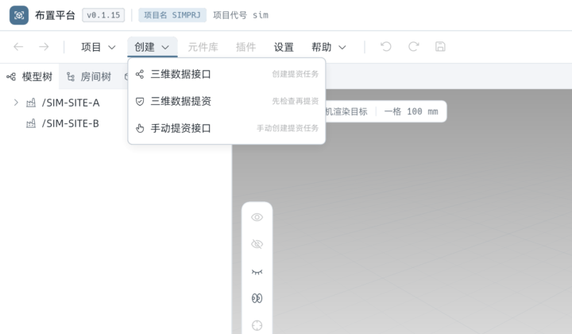

第 2 – 3 步：

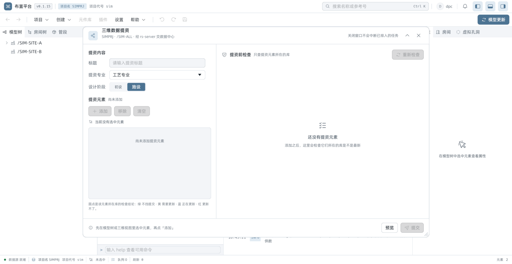
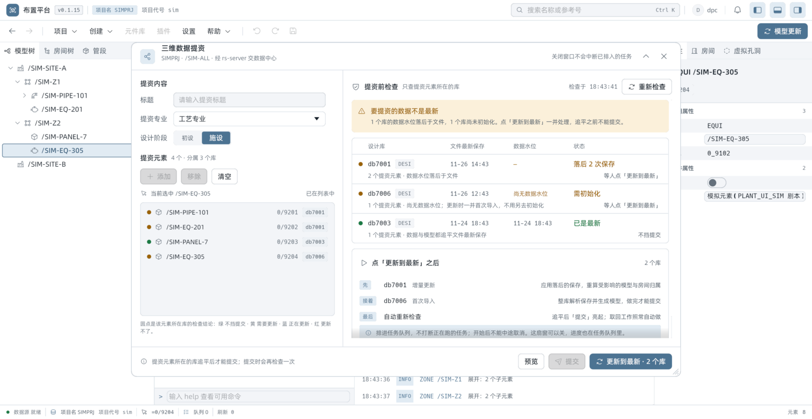

第 4 – 6 步：

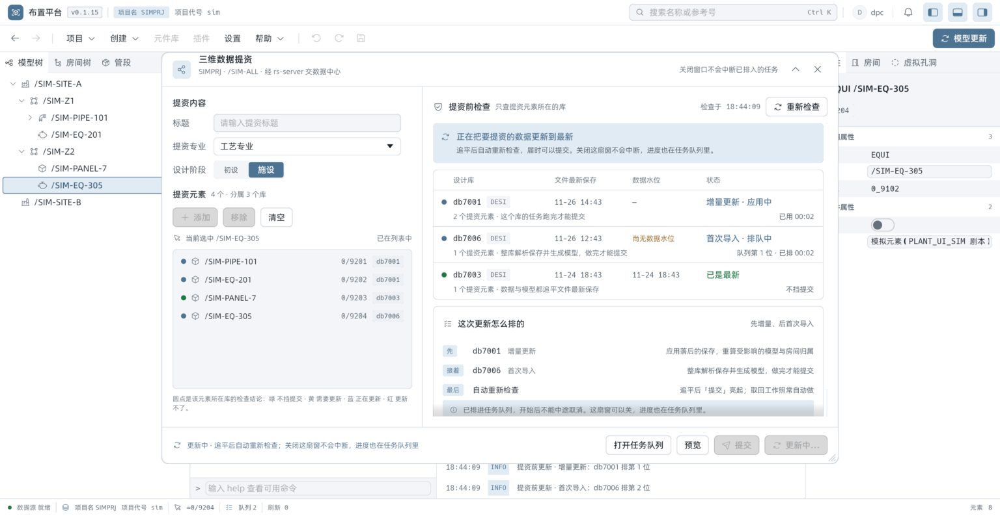
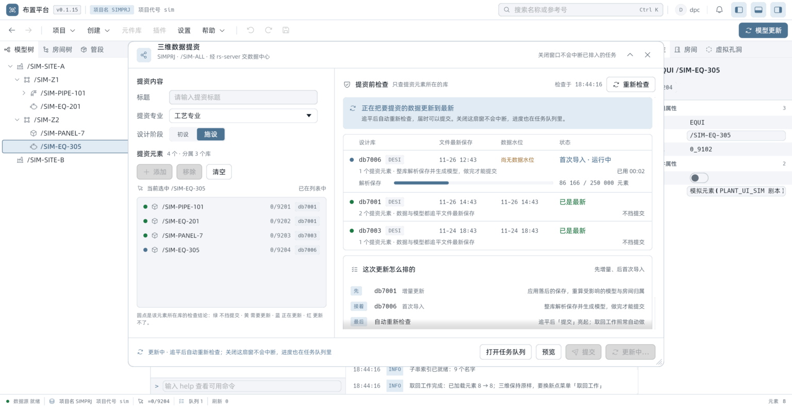
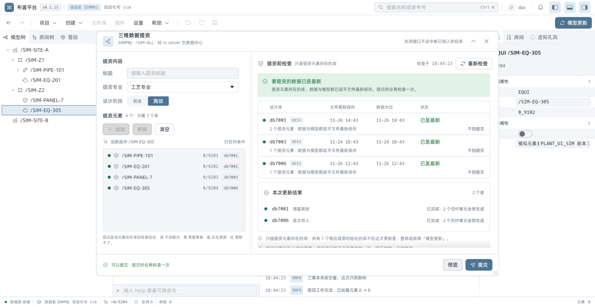

第 7 步（没人点，窗口自己发现文件又存了一次）：

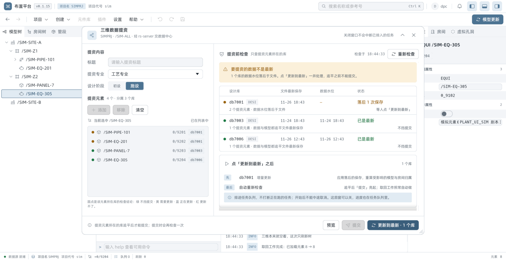

第 8 – 9 步：

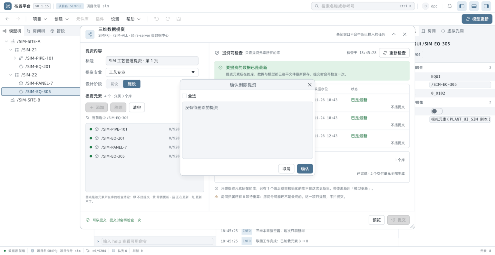
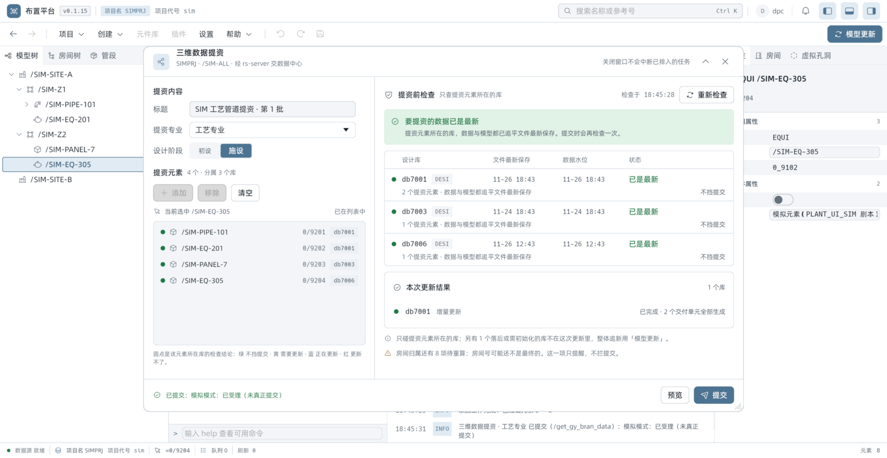

第 10、12、14 步：

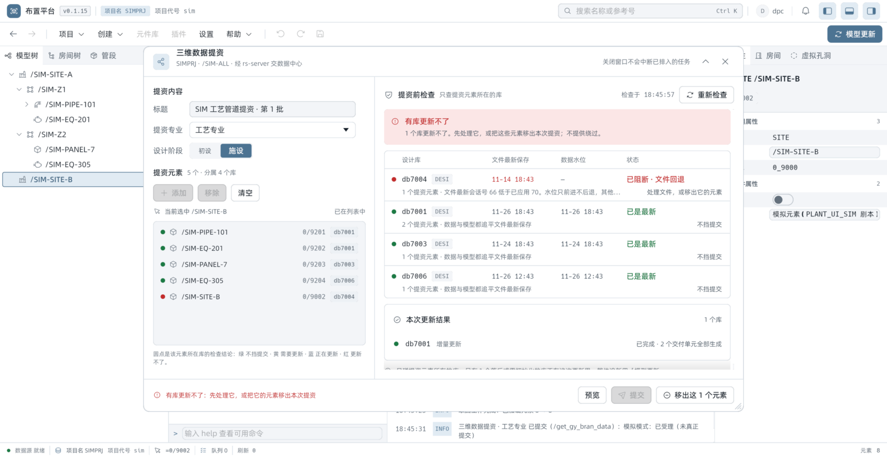
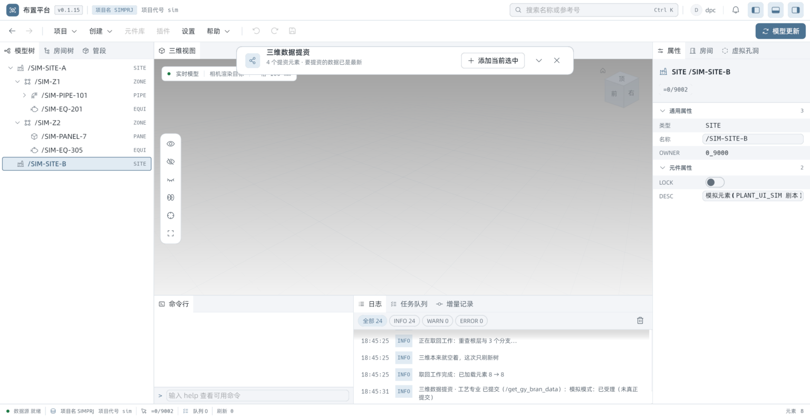
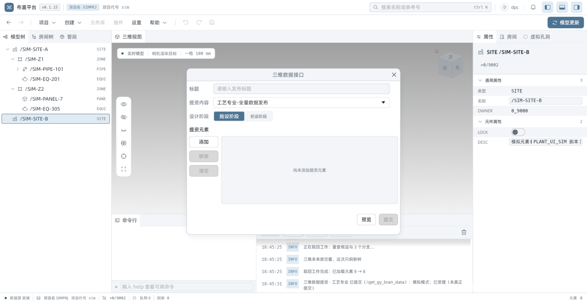

## 二、九个形态（画廊）

场景名单与各自摆的事实在 `crates/plant-ui-app/src/gallery_handover.rs` 文件头。后缀 `@dark` 换深色主题。

| 场景 | 形态 | 画板 | 图 |
|---|---|---|---|
| `s15` | 需要更新（一个库落后、一个库需初始化） | S15 | [浅色](assets/2026-11-26-data-handover-s15-light.png)、[深色](assets/2026-11-26-data-handover-s15-dark.png) |
| `s15-a` | 更新中（增量在跑、首次导入在排） | S15-A | [深色](assets/2026-11-26-data-handover-s15-a-dark.png) |
| `s15-import` | 首次导入在跑，带解析保存进度（任务不是从这扇窗发起的） | S15-C | [深色](assets/2026-11-26-data-handover-s15-import-dark.png) |
| `s15-b` | 更新落定、已是最新，带本次更新结果 | S15-B | [深色](assets/2026-11-26-data-handover-s15-b-dark.png) |
| `s15-stuck` | 有库更新不了（够不着、文件回退、上次更新失败、元素已删除） | S15-C | [深色](assets/2026-11-26-data-handover-s15-stuck-dark.png) |
| `s15-unknown` | 没查成 | S15-C | [浅色](assets/2026-11-26-data-handover-s15-unknown-light.png) |
| `s15-unsupported` | 这台模型服务不支持提资前检查（不拦） | S15-C | [浅色](assets/2026-11-26-data-handover-s15-unsupported-light.png) |
| `s15-empty` | 还没有提资元素 | — | [浅色](assets/2026-11-26-data-handover-s15-empty-light.png) |
| `s15-bar` | 收成一条 | — | [深色](assets/2026-11-26-data-handover-s15-bar-dark.png) |

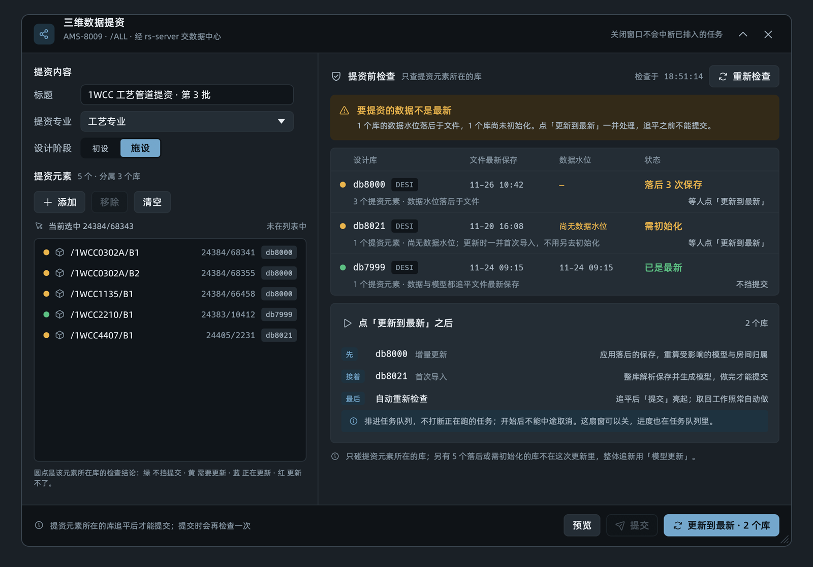
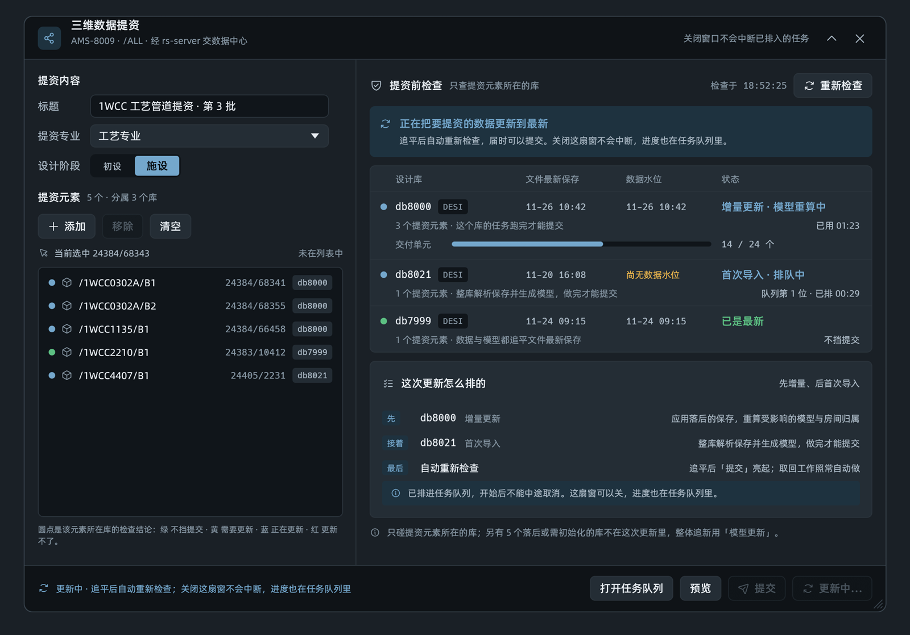
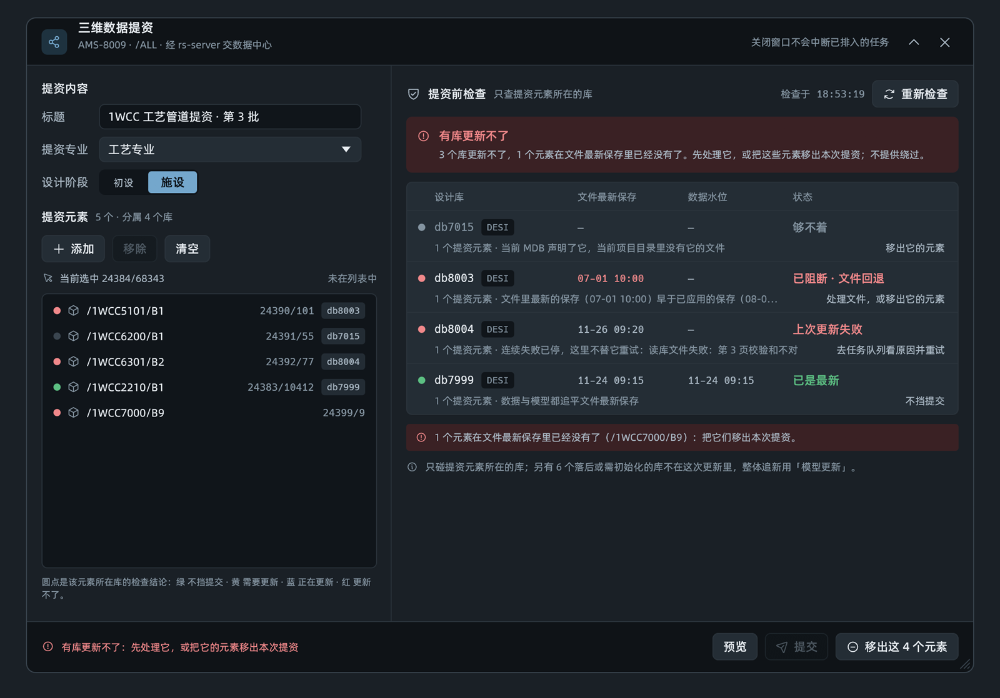

## 三、和画板不一样的地方

都是「服务端今天给不出」的那几格，逐格在 `design/DATA-PUBLISH-FIELD-MAP.md` 里标着「待新增 G1 – G5」：

- 落后时「数据水位」那一格留空（画板上是停在哪一次保存的时刻）。
- 行状态写「增量更新」，没有「优先」「已提到队首」；进度只有一条「交付单元」，不分提资单元与其余单元。
- 放行按库：更新过的库要等整库任务跑完；卡片第三步是「自动重新检查」，不是「其余单元后台继续」。
- 房间归属还在重算时只提醒、不拦（第 9 步的脚注）。

实施中加的、画板上没有的：元素列表底下的圆点图例、「这些库的任务不是从这扇窗发起的」提示条、收起条上的「添加当前选中」。

## 四、这一次没验到的

- **真 gen-model、真 rs-server**：检查（只读）、执行、提交都没有对真服务发过。执行与提交会改数据，要有授权和环境。
- **「点提交那一刻才发现不是最新」这条分支**在最终构建的窗口里没再撞上：加了第 7 步的自动重新检查之后，窗口总是抢先发现。
  较早的一份构建（17:21，还没有自动重新检查）手动点时撞上过一次，底栏写「提交前重新检查：要提资的数据不是最新，这次没有提交」，
  没留图；这条分支现在由单测 `submit_checks_again_first_and_only_then_looks_up_deletions` 守着。
- 队列暂停、读透形态（判不了）、模型服务连不上（没查成）在模拟模式里没走：只有画廊图与单测。
- 浏览器版（wasm）没有构建、没有看。

## 复跑要点

- 探针用专用口（这次 5747），默认口 5719 上可能是别人的实例；exe 改名再起。
- 自绘按钮不进 AccessKit 树，窗口（`Window` 角色）、菜单项（`Button`）、模型树行（`TreeItem`，文本里带 `name=`）进。
  先 `inspect tree 三维数据提资` 拿窗口包围盒，再按相对位置点：「添加」在窗口左上角起 (50, 253)；标题输入框 (215, 109)；
  底栏按钮贴右下，离底 29，离右：提交 48（旁边没有主操作时）、更新到最新 96、移出 87、预览 120；「收成一条」离右 66、离顶 26。
- 剧本里第一轮房间收敛的同一拍 db7001 / db7002 会各再存一次盘（一次性），第 7 步看的就是它；要再看一遍得重起实例。
- 本机显示缩放中途从 250% 变成了 200%（18:48 前后），画廊窗口的像素尺寸跟着变（3846×2235 → 3204×2060），
  裁图比例要跟着换；逻辑布局不受影响。所以整条路那组图是 250% 下拍的，画廊那组是 200% 下拍的。
- 机器上同时有别的会话在编同一个仓库，共用构建目录会互相等锁；撞出过一次三方互等（几个 cargo 都不占 CPU、没有 rustc
  子进程，日志停在 `Blocking waiting for file lock on …`），停掉自己那一个就解开了。
